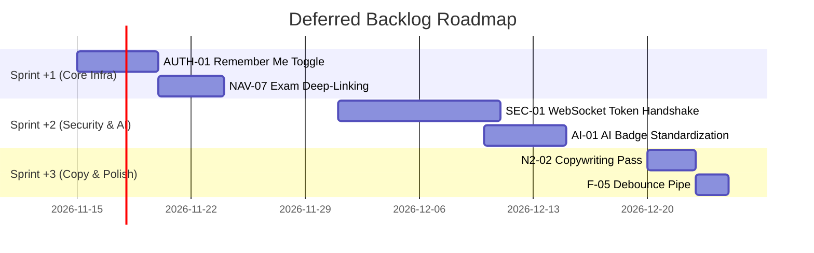

# Deferred Backlog — Future Enhancements & Architectural Roadmap

> **Platform**: Masarak LMS (منصة مسارك التعليمية)  
> **Document Date**: 2026-11-02  
> **Status**: Approved Post-Release Backlog  
> **Reference Plan**: [`PHASE_4_QUALITY_GATE_AND_RELEASE.md`](file:///d:/Masarak/implementation-plan/PHASE_4_QUALITY_GATE_AND_RELEASE.md)  

---

## 1. Overview & Prioritization Criteria

During the 4-phase UX and architectural stabilization program (Phases 1–3 and Quality Gate Phase 4), all critical (P0) and high-priority (P1) UX/UI, accessibility, and navigation findings were fully resolved.

This backlog documents **non-blocking architectural items**, **future backend-dependent enhancements**, and **micro-copywriting improvements** intentionally deferred to maintain release velocity and architectural stability.

### Priority Definitions
- **P2 (Medium)**: Architectural or security enhancements recommended for the next major infrastructure release.
- **P3 (Low)**: Minor workflow polish, micro-copywriting tweaks, or optional UX enhancements.

---

## 2. Deferred Items Register

| Item ID | Finding / Requirement | Source | Priority | Reason for Deferral | Recommended Architecture & Action Plan |
|:---:|---|:---:|:---:|---|---|
| **SEC-01** | JWT Token in WebSocket URL query string | Report 3 | **P2** | Architectural backend & transport protocol change. Currently, `SignalR` passes the token via `accessTokenFactory` in query parameters. Moving to cookie-based authentication or a ticket-based handshake requires coordinated backend ASP.NET Core SignalR hub modifications. | **Backend/Infra**: Implement short-lived ticket exchange or HTTP-only signed cookies for WebSocket connection establishment. |
| **NAV-07** | Direct Exam Deep-Linking (`/exams/:id`) | Report 3 | **P3** | Route design decision. Currently, `/dashboard/student/exams/:id` redirects to the comprehensive exams list view (`/dashboard/student/exams`), which auto-selects the first relevant group. Implementing deep linking requires modifying `StudentExamsPageComponent` to parse URL query params and auto-trigger attempt selection. | **Frontend**: Add query param listener (`route.queryParams['examId']`) in `StudentExamsPageComponent` to automatically set `selectedExamId`. |
| **F-05** | Form Submission Debounce on Signup | Report 3 | **P3** | The register button already sets `authState.isLoading(true)` and disables (`[disabled]="authState.isLoading() || registerForm.invalid"`), successfully preventing accidental double clicks in practice. An RxJS `debounceTime(300)` operator provides marginal additional safety. | **Frontend**: Add `debounceTime(300)` pipeline on reactive form submission streams if high-latency networks produce edge-case duplicates. |
| **N2-02** | Registration Terminology Alignment | Report 1 | **P3** | Purely a copywriting refinement between "تسجيل حساب جديد" and "إنشاء حساب". Both terms are understood across the Arab world, but platform-wide uniformity is preferred. | **Design/Content**: Standardize copy platform-wide to "إنشاء حساب" (Create Account) in the next marketing/copywriting pass. |
| **AUTH-01** | "Remember Me" Toggle on Login | Report 2 | **P3** | Requires changing auth persistence strategy. Currently, JWT access and refresh tokens are securely stored in `localStorage` across browser sessions. Implementing "Remember Me" requires conditionally toggling between `localStorage` (persistent) and `sessionStorage` (tab/session scoped). | **Frontend**: Add "تذكرني" checkbox to `login.html`; update `AuthStateService` to write tokens to `sessionStorage` when unchecked. |
| **AI-01** | AI Content Attribution Badge Standardization | Report 3 | **P2** | AI-generated features (AI Insights, Smart Reports) currently display sparkles icons and AI banners. A standardized runtime watermark badge ("تم التوليد بواسطة الذكاء الاصطناعي") across all dynamic LLM response payloads requires runtime payload tagging from backend AI microservices. | **Fullstack**: Standardize a backend metadata flag (`isAiGenerated: true`) on AI report endpoints and render a standardized `<app-ai-badge>` component. |
| **P4-01** | Bundle Size Optimization for Agora RTC | Phase 4 Audit | **P3** | `agora-rtc-sdk-ng` is currently lazy-loaded via `chunk-CM6QR7BJ.js` (1.59 MB raw / 321 kB transfer) only on `/sessions/:id/live`. It does not affect initial bundle load (`1.26 MB` raw / `236 kB` transfer). | **Frontend**: Investigate dynamic dynamic-import or CDN script tag loading for Agora WebRTC if low-bandwidth student environments require even smaller chunks. |

---

## 3. Implementation Schedule & Ownership

---

## 4. Maintenance Guidelines

- Any new minor finding discovered in staging should be appended to this backlog with its priority and rationale.
- Critical (P0) or High (P1) issues must not be deferred and must be remediated immediately prior to production deployment.
